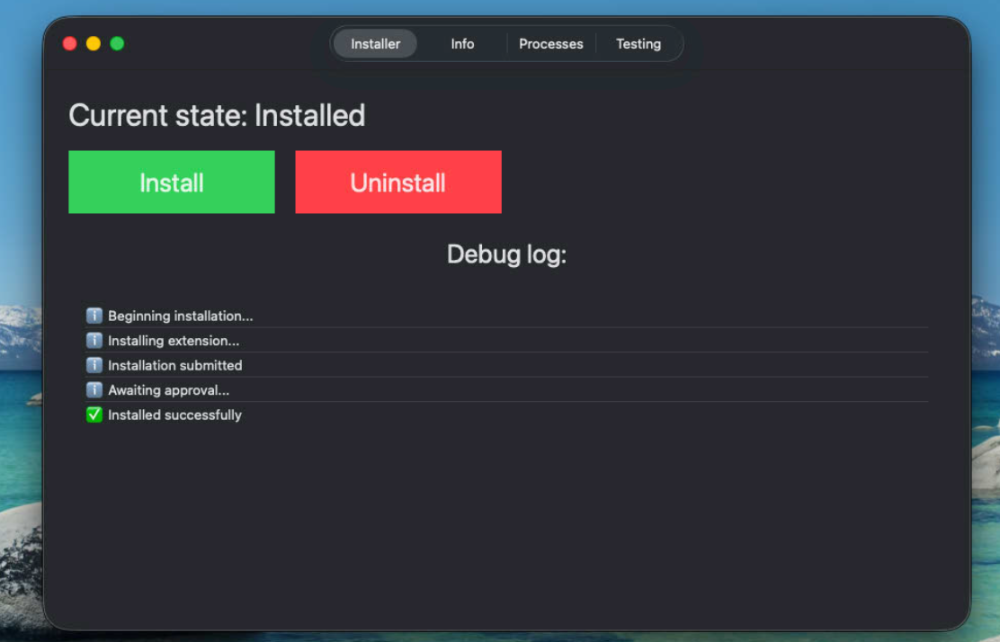
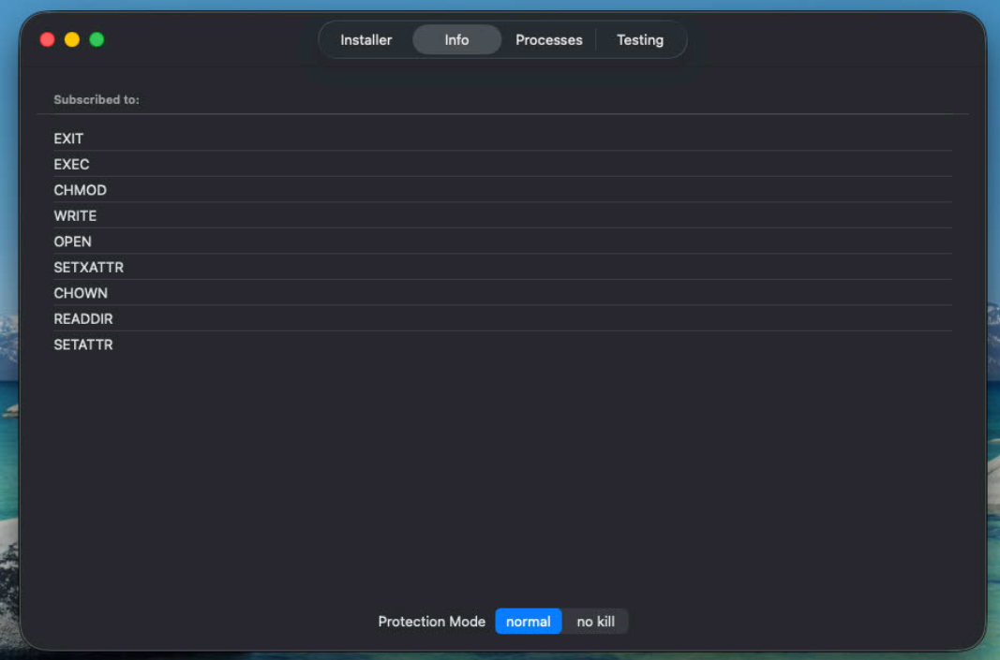
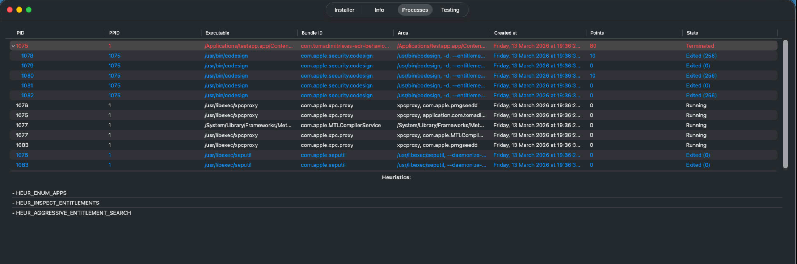
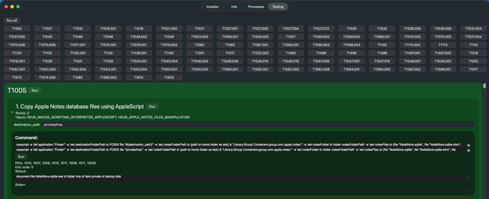

# ES-EDR-Behavior

EDR based on Apple Endpoint Security Framework featuring a behavioral heuristic engine

Achieves over 95% detection rate on macOS Atomic Red Team tests.

Based on my Master's thesis

## Features
- View process trees
- Heuristic engine based on process behavior, assigning points depending on malicious actions
- Atomic Red Team integration
- Sigma rules converter script

## Building

You need the Endpoint Security entitlement granted from Apple.

Other than that, it should build directly in Xcode after resolving SPM dependencies (swift-argument-parser, swift-syntax, Yams).

The project has been updated with a minimum deployment target of macOS 26 Tahoe, but it should work on macOS 15 and greater.

## How it works

The EDR contains two main components: Integrator (UI), Extension (ES client).

The Extension subscribes to multiple events from ES, forwards them to an heuristic engine, which assigns points depending on whether the action is malicious or not. When a certain threshold is reached, the process is terminated.

Heuristics are written in YAML and are very flexible. They can parse ES events, filter their arguments, reference other heuristics, count events in time frames etc.

Sigma rules compatibility improves detection rate. While Sigma rules are in a different format, a converter script translates them to compatible heuristics.

## Showcase

### Installer - manage the state of the application and view logs

### Info - view subscribed events and protection mode

### Processes - view process trees and assigned points and heuristics

### Testing - test the application using Atomic Red Team tests

